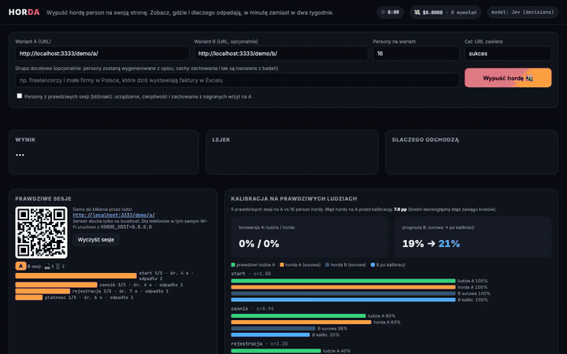
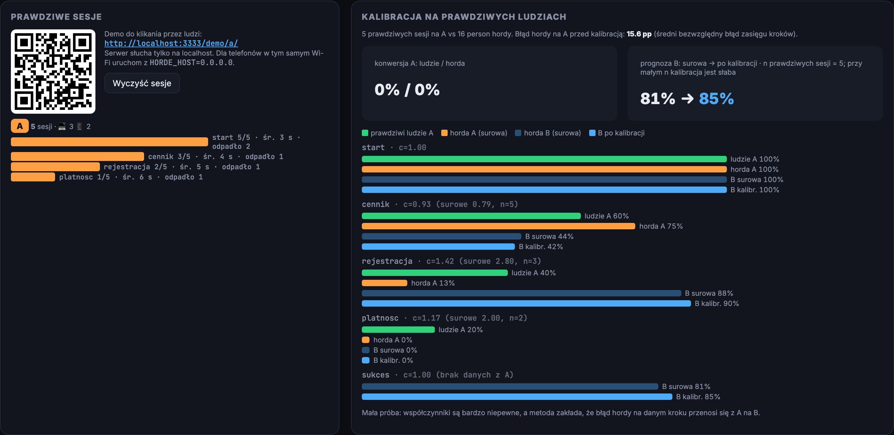

# Horda 🐝

**Problem:** po każdej zmianie landingu czy onboardingu na feedback od użytkowników czeka się dni albo tygodnie
(A/B test na prawdziwym ruchu potrzebuje setek–tysięcy wizyt, żeby cokolwiek wykazać).

**Horda:** wypuszczasz na swoją stronę (albo na dwa warianty naraz) kilkanaście person-agentów. Każdy dostaje prawdziwą
przeglądarkę (Playwright), czyta stronę, klika, wypełnia formularze i odchodzi wtedy, kiedy odszedłby człowiek.
Po około minucie masz:

- **lejek** (ile osób doszło do którego kroku) dla A i B obok siebie,
- **gdzie i dlaczego odpadają** (kategorie powodów + cytaty z „ankiety wyjścia”),
- **konwersję z przedziałem ufności** i **test istotności** różnicy A vs B,
- **podsumowanie analityka** z 3 problemami i 3 zmianami do przetestowania,
- **koszt przebiegu** (zwykle ułamek centa) i podgląd na żywo, co widzi i myśli każdy agent.



Wideo (10 s, 16 person × A/B): [`docs/demo.mp4`](docs/demo.mp4)

## Uruchomienie

```bash
cd horda
npm install
npx playwright install chromium   # albo pomiń: użyje zainstalowanego Chrome
cp .env.example .env              # wpisz OPENROUTER_API_KEY
npm start                         # http://localhost:3333
```

Domyślnie panel ma wpisane dwa warianty demo (`/demo/a/` i `/demo/b/`) fikcyjnej apki do faktur „Fakturix”
i cel „URL zawiera `sukces`”. Można wpisać dowolny URL (np. apki innych drużyn z hackathonu).

## Mózg agentów: Jev (decyzje z rozkładem prawdopodobieństwa)

Domyślnie (`HORDE_BRAIN=jev`) o każdym kroku agenta decyduje **Jev** (`~typesafe/jev-latest`, TypeSafe) przez
OpenRouter Decisions API (`POST /api/alpha/decisions`). Jeden krok = jedno żądanie: w `state` idzie opis persony,
ostatnie kroki, tytuł strony, jej tekst i lista pól formularza, a pytania są typowane:

- `action` (choice): `leave` (persona zamyka kartę teraz), `scroll`, `fill_form` (tylko gdy są pola) i po jednej opcji
  `el_<id>` na każdy klikalny link/przycisk (opis = jego tekst, maks. 60),
- `reason` (choice): kategoria powodu, gdyby persona odeszła teraz (cena, ukryte koszty, zaufanie, niejasna wartość…),
- `mood` (score 1–5).

Akcję **losujemy z rozkładu** zwróconego przez Jev, wyostrzonego `p^1.5` i znormalizowanego (`HORDE_SHARPEN`), żeby linki z p≈0.02 rzadko wygrywały (seedowany RNG per persona, ten sam w A i B), zamiast brać argmax.
Dzięki temu persony z podobnym rozkładem robią różne rzeczy, tak jak ludzie, a `p_leave` (prawdopodobieństwo odejścia
na danym kroku) jest wprost mierzalne: kafelek pokazuje np. `→ klik „Wypróbuj za darmo” (p=0.72) · odejście p=0.08`,
a wynik zapisuje per krok `{action, p, p_leave, top, mood}`.

Jev nie pisze tekstu, więc:
- formularze wypełniamy deterministycznie danymi persony po typie/etykiecie pola (e-mail `imie.N@example.com`, NIP,
  telefon, hasło spełniające silne reguły, karta testowa 4242…, 2. opcja selecta, wymagane zgody) i klikamy „wyślij”,
- cytat z ankiety wyjścia pisze jedno krótkie wywołanie taniego modelu czatu (`HORDE_QUOTE_MODELS`, domyślnie
  `openai/gpt-oss-120b`), a gdy się nie uda, bierzemy szablon dla danego powodu,
- podsumowanie analityka i persony z opisu grupy docelowej nadal robi model czatu (`HORDE_MODELS`).

**Dlaczego Jev:** zamiast wolnego tekstu i parsowania JSON-a dostajemy skalibrowane prawdopodobieństwa, które da się
uśredniać, porównywać między wariantami i z których można losować. Jev liczy tylko tokeny wejściowe, więc jest tani:
przebieg demo 8 person × 2 warianty kosztuje ok. $0.006 (z czego większość to cytaty i podsumowanie) i trwa ok. 10 s.

Stary mózg (model czatu zwraca JSON z akcjami) jest dostępny przez `HORDE_BRAIN=llm`. Twardy limit wydatków na
przebieg (Jev + czat razem): `HORDE_BUDGET_USD`. Każdy przebieg zapisuje się do `runs/` (poza gitem).

## Prawdziwe sesje, persony-bliźniaki i kalibracja

Horda sama w sobie to symulacja. Żeby ją uziemić, demo nagrywa też **prawdziwe wizyty ludzi** (podobnie jak narzędzia
odtwarzające prawdziwy ruch, np. Meticulous):

- `demo-site/recorder.js` (bez zależności) jest na każdej stronie demo A i B. Na każdą odsłonę zapisuje: id sesji
  (`sessionStorage`), wariant, krok, urządzenie (mobile < 700 px), czas na stronie, maks. głębokość przewinięcia,
  kliknięcia, „rage clicks” (3+ kliknięcia w ten sam element w < 1 s), wejścia w pola formularza i czy to było wyjście.
  Wysyła to przez `navigator.sendBeacon` na `POST /api/sessions`; serwer dopisuje do `runs/sessions.jsonl` (poza gitem).
  Agenci hordy mają ustawione `window.__HORDE_AGENT`, więc ich ruch się nie nagrywa.
- `GET /api/sessions` zwraca agregaty per wariant (liczba sesji, lejek, miejsce odpadnięcia, średni czas na kroku,
  urządzenia), a `POST /api/sessions/clear` (przycisk „Wyczyść sesje”) czyści nagrania.
- Domyślnie serwer słucha tylko na localhost. Żeby koledzy w tym samym Wi-Fi mogli klikać demo na telefonach, uruchom
  `HORDE_HOST=0.0.0.0 npm start`: serwer wypisze adres w sieci lokalnej, a panel pokaże go z kodem QR.

**Persony-bliźniaki** (checkbox „Persony z prawdziwych sesji”): gdy są nagrane sesje na A, każda persona dostaje
urządzenie, cierpliwość (z liczby kroków i czasu sesji) i zdanie w prompcie w rodzaju „W prawdziwej sesji ta osoba:
weszła z telefonu; start: 4 s, przewinęła 100%, kliknęła „Dowiedz się więcej”; cennik: 6 s; odpadła na: cennik”.
Przy mniejszej liczbie sesji niż person sesje się powtarzają. Te same persony idą na B, więc projekt sparowany zostaje.
Uwaga: bliźniak „zna” prawdziwą ścieżkę na A, więc jego wynik na A nie jest niezależnym sprawdzianem hordy.

**Kalibracja** (sekcja „Kalibracja na prawdziwych ludziach”, gdy są sesje na A i jest przebieg hordy): dla każdego
kroku lejka A liczymy prawdopodobieństwo przejścia dalej u ludzi i u hordy, z wygładzeniem Laplace'a
`cont_k = (n_k + 1) / (n_{k-1} + 2)`, i współczynnik `c_k = cont_ludzie / cont_horda` (przycięty do 0,2–5), który potem ściągamy do 1 zależnie od liczby
prawdziwych sesji `n` na poprzednim kroku: `c_k = 1 + (c_k − 1) · n / (n + 10)`, przycięte do 0,5–2 (przy 5 sesjach zostaje
1/3 poprawki, przy 90 sesjach 90%). Bez tego kilka sesji potrafiło wypchnąć prognozę B do 100%.
Te same współczynniki (po nazwie kroku; kroki, których nie ma na A albo bez danych, dostają 1) mnożą zasięg kroków
hordy na B w skali szans (odds): odds(zasięg_k(B)) = odds(surowy zasięg_k(B)) × iloczyn c_j po krokach B do k, czyli
przesunięcie w skali logit jak w kalibracji Platta; dzięki temu prognoza nie przekracza 100%. Panel pokazuje dla każdego kroku ludzi A,
hordę A, surową hordę B i B po kalibracji, prognozę konwersji B przed/po oraz błąd hordy na A przed kalibracją
(średni bezwzględny błąd zasięgu kroków w punktach procentowych).

To ten sam pomysł co kalibracja Platta (Platt 1999, *Probabilistic Outputs for Support Vector Machines*): surowe
wyjście modelu dopasowujemy do prawdziwych częstości na zbiorze z etykietami, tu po prostu per krok lejka.
Ograniczenia: (1) przy kilku sesjach współczynniki są bardzo niepewne; (2) metoda zakłada, że błąd hordy na danym kroku
przenosi się z A na B, a zmiana na B może zmienić właśnie zachowanie, którego dotyczy błąd; (3) LLM-y dobrze oddają
kierunek zachowań grup, gorzej ich rozkład (Argyle i in. 2023, https://doi.org/10.1017/pan.2023.2), dlatego
kalibrujemy rozkład na ludziach zamiast mu ufać.

Test (tylko do sprawdzenia działania): 5 „prawdziwych” sesji na A wygenerowaliśmy zwykłym skryptem Playwright z ludzkimi
opóźnieniami (nie agentem) i po teście usunęliśmy je z `sessions.jsonl`. Zrzut panelu: `docs/screenshot.png`.



## Dlaczego to nie jest „LLM zgaduje”

1. **Persony nie są wymyślane przez model.** Modele zbiegają do mediany, więc persony „z LLM” są do siebie podobne.
   Cechy zachowania losujemy z rozkładów z badań (seedowany RNG):
   - główna obawa przy zakupie: rozkład powodów porzucania checkoutu z badania Baymard Institute
     (dodatkowe koszty 48%, wymuszone konto 26%, brak zaufania 25%, za długi proces 22%, brak pełnej ceny 21%…)
     – https://baymard.com/lists/cart-abandonment-rate
   - sposób czytania: 79% użytkowników skanuje, 16% czyta słowo po słowie – Nielsen (1997),
     https://www.nngroup.com/articles/how-users-read-on-the-web/
   - szybkie odchodzenie, gdy wartość jest niejasna (pierwsze 10–20 s decydują) – Nielsen (2011),
     https://www.nngroup.com/articles/how-long-do-users-stay-on-web-pages/
   - urządzenie: ok. 60% ruchu webowego to mobile – StatCounter, https://gs.statcounter.com/platform-market-share/desktop-mobile-tablet
   - rola/sytuacja: z opisu grupy docelowej (jedno wywołanie LLM) albo z listy domyślnej.
2. **Projekt sparowany.** Te same persony przechodzą przez A i B, więc porównujemy pary, a nie dwie losowe grupy.
   Różnicę testujemy **dokładnym testem McNemara** (liczy się tylko, kto konwertuje na jednym wariancie, a na drugim nie).
   Konwersje mają **przedział Wilsona 95%**, który zachowuje się dobrze przy małych próbach.
3. **Prawdziwa przeglądarka, prawdziwe ekrany.** Mobile dostaje viewport 390 px i dotyk, więc banner cookies
   zasłaniający pół ekranu albo 10-polowy formularz naprawdę przeszkadza.

## Ograniczenia (uczciwie)

To symulacja. Badania nad „silicon samples” pokazują, że LLM-y dobrze odtwarzają *kierunek* zachowań grup
(Argyle i in. 2023, *Out of One, Many*, Political Analysis, https://doi.org/10.1017/pan.2023.2), ale gorzej ich
wariancję i dokładne liczby. Horda jest więc szybkim filtrem hipotez („który wariant ma oczywisty problem i gdzie”)
przed testem na prawdziwym ruchu, a nie jego zamiennikiem. Procenty konwersji z hordy nie są prognozą prawdziwej konwersji.

## Struktura

- `server.js` – serwer HTTP, SSE z podglądem na żywo, orkiestracja przebiegu
- `lib/agent.js` – pętla agenta: ekstrakcja elementów strony → decyzja (Jev albo LLM) → akcje Playwright
- `lib/jev.js` – klient OpenRouter Decisions API (Jev) i losowanie z rozkładu
- `lib/personas.js` – generator person z rozkładów z badań
- `lib/stats.js` – lejek, Wilson, McNemar
- `lib/sessions.js` – prawdziwe sesje: zapis, agregacja, persony-bliźniaki, kalibracja
- `demo-site/recorder.js` – rejestrator sesji na stronach demo
- `lib/llm.js` – klient OpenRouter z licznikiem kosztu i limitem budżetu
- `public/index.html` – panel
- `demo-site/a`, `demo-site/b` – dwa warianty demo landingu
